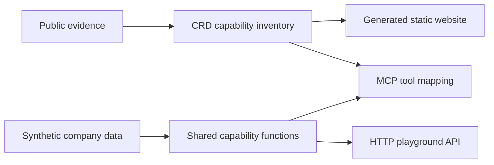

# Architecture

The diagram is illustrative. The CRD files are the semantic source of truth. Website pages are generated projections. MCP tools and HTTP routes call the same software-primary capability functions. The decision brief composes several capabilities while retaining their separate CRDs.

